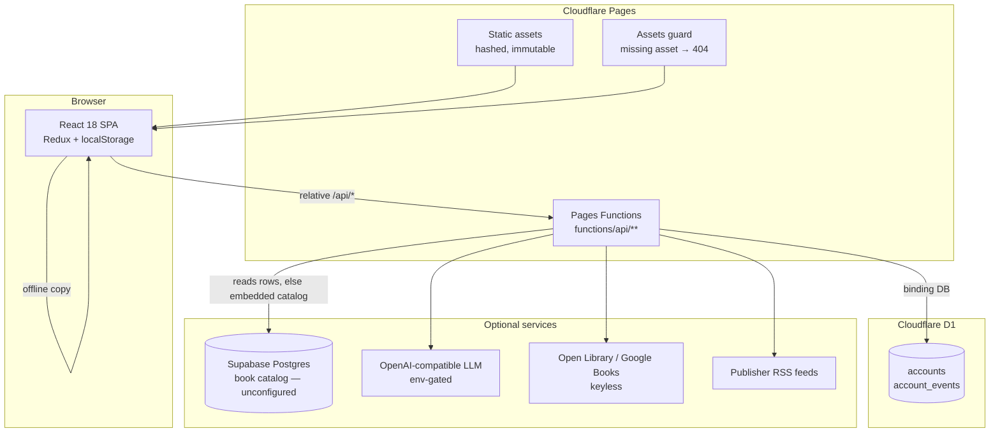
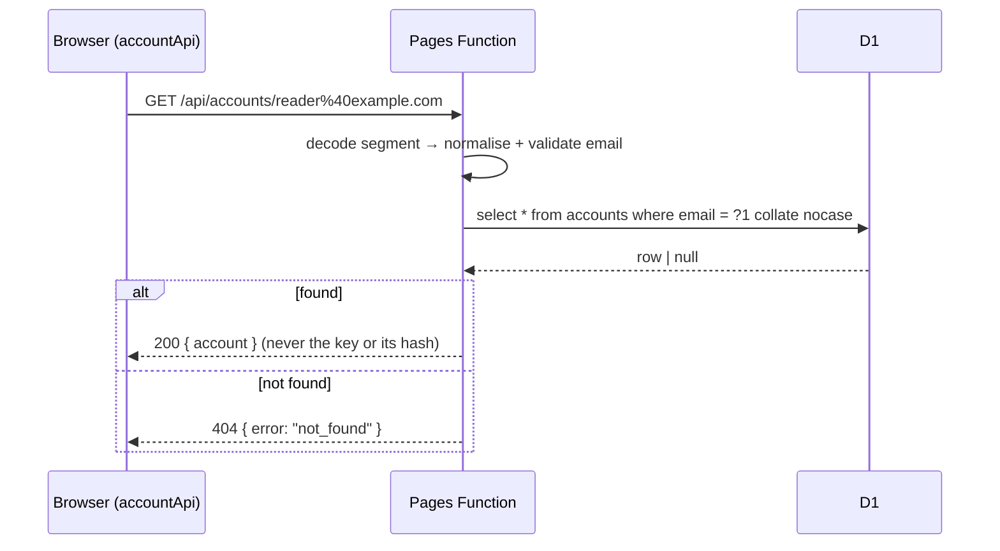

# 🏗️ Architecture (deployed system)

> This file describes **what runs in production**. For the un-deployed Python/ML
> stack see [`docs/ARCHITECTURE.md`](docs/ARCHITECTURE.md); for operations see
> [`docs/LIVE_ARCHITECTURE_RUNBOOK.md`](docs/LIVE_ARCHITECTURE_RUNBOOK.md).

## 1. Topology



**Why this shape:** the product is already served from Cloudflare; a Pages Function
adds no host, no pool, and no cold-start penalty at this scale. Every request is
same-origin, so there is no CORS surface and no API key in the browser bundle.

## 2. Request lifecycle — `GET /api/accounts/:email`



Writes follow the same path and additionally require `X-Account-Key`; the server
hashes it (SHA-256) and compares in constant time. Full contract:
[`docs/ACCOUNTS.md`](docs/ACCOUNTS.md).

## 3. State model — where every piece of data lives

| Data | Store | Durability | Authority |
|---|---|---|---|
| Account profile (name, genres, moods, goal, level) | **D1** `accounts` + `localStorage` mirror | Survives browser wipe / device change | D1 |
| Account write credential | `localStorage` (`goodbooks_account_key`, raw key; hash in D1) | Device-bound | D1 hash |
| Wishlist, reading progress, notes, goals, theme | Redux → `localStorage` | Per browser | Client |
| Book catalog | Embedded `shared/book-catalog.json` (Supabase Postgres optional) | Shipped with the deploy | Catalog file |
| Recommendation audit / reading events | Supabase (write-only) | No-op while `SUPABASE_URL` is unset | — |
| AI conversations | Stateless at the edge; context sent per request | Not persisted | — |

Rule of thumb: **anything a customer would be upset to lose on a new device
belongs in D1**, everything else stays local until it earns a table.

## 4. Recommendation engine (why it is small)

`functions/api/_lib/recommender.ts` is a deliberately lightweight hybrid:

1. **TF-IDF + cosine similarity** over weighted fields (genres ×5, moods ×3,
   title ×4, authors ×2, description ×1) for free-text and "more like this".
2. **Profile scoring** — genre 45% / mood 20% / rating 15% / popularity 10% / recency 10%.
3. **MMR diversity** (λ = 0.3) so the top list is not repetitive.
4. **Genre-alias normalisation** (`sci-fi` → `Science Fiction`) — without it the
   45% genre weight silently collapses to zero.

No embeddings and no collaborative filtering until there is interaction volume to
learn from. Rationale and the comparison table: [`docs/DATA_LAYER.md`](docs/DATA_LAYER.md).

## 5. Security boundaries

| Boundary | Control |
|---|---|
| Browser → API | Same-origin relative URLs, strict CSP (`connect-src 'self'`), no CORS grant |
| Secrets | Pages secrets only (`SUPABASE_SERVICE_ROLE_KEY`, `MINIMAX_API_KEY`, `OPENAI_API_KEY`); `VITE_*` is public by definition |
| Account writes | 256-bit key, SHA-256 at rest, constant-time compare, `Cache-Control: no-store`, `409` on an existing email without a key |
| Abuse control | Per-client fixed-window limits in D1 (hashed IPs) on `/api/accounts` and `/api/ai/*`; AI also rejects cross-origin, non-JSON and >64 KB bodies |
| Account reads | **Owner-only** (`X-Account-Key`); unknown account answers like a wrong key (401), so existence is not observable |
| Headers | HSTS, `X-Frame-Options: DENY`, `nosniff`, referrer + permissions policy |
| Edge misconfiguration | CI smoke test fails the deploy if `/api/accounts` is not `{"database":"d1",…}` |

## 6. Delivery pipeline

```text
push to main → GitHub Actions (type-check → lint → test → build → purge Apple-Double
→ wrangler pages deploy → live smoke test)  → Cloudflare Pages (production branch)
```

Local equivalent: `npm run deploy`. D1 schema is applied explicitly and rarely
(`npm run db:schema`); it is idempotent and not part of every deploy.

## 7. The legacy stack (not deployed)

`src/api/main.py` (FastAPI), `src/core`, `src/models`, Redis, PostgreSQL,
Terraform, Kubernetes, Docker, the news/false-news subsystems. It contains the
collaborative-filtering and training code that this product may need later, but
it does **not** serve the frontend today. See
[`docs/ARCHITECTURE.md`](docs/ARCHITECTURE.md) and
[`docs/DEPLOYMENT_PLAN.md`](docs/DEPLOYMENT_PLAN.md).
