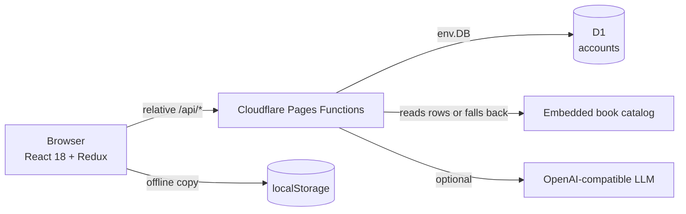

# 🤝 GoodBooks Recommender — Developer Handoff

> **Canonical onboarding document for humans.** Read this first, then
> [`AGENTS.md`](AGENTS.md) (agent/contributor rules) and
> [`docs/LIVE_ARCHITECTURE_RUNBOOK.md`](docs/LIVE_ARCHITECTURE_RUNBOOK.md) (operations).
>
> Verified against production on **2026-11-17**. The root-level
> `*_COMPLETE*.md` / `MISSION*.md` reports that used to live here are historical
> and now sit in [`docs/archive/`](docs/archive/README.md).

---

## ⏱️ In 5 minutes

**What this is**: a book-recommendation product with a real, deployed edge backend.

- **Live**: <https://books.dalecabra.com> — React 18 + Vite SPA on Cloudflare Pages.
- **API**: Cloudflare **Pages Functions** (`functions/api/**`). No server to run
  locally and no Python service in production.
- **Accounts**: durable in **Cloudflare D1** (`goodbooks-accounts`), surfaced
  through `/api/accounts`. See [`docs/ACCOUNTS.md`](docs/ACCOUNTS.md).
- **Reader data** (wishlist, progress, notes): Redux + `localStorage`, offline-first.

```bash
npm ci                  # install
npm run dev             # Vite on :3000
npm run type-check && npm test && npm run lint   # the gates CI runs
npm run deploy          # build + publish to Cloudflare Pages (main)
```

There is nothing else to start. `src/api` (FastAPI) is a **legacy** stack kept
for a future ML host — see [Legacy stack](#-the-legacy-stack-dont-confuse-it-with-production).

---

## 🗺️ In 30 minutes

### Architecture (what actually runs)



- Same-origin API calls only: no CORS, no keys in the browser bundle, CSP stays strict.
- Every API route degrades gracefully; the product works with the network down.
- Full endpoint list: [`docs/API_REFERENCE.md`](docs/API_REFERENCE.md) and
  [`API_CATALOG.md`](API_CATALOG.md).

### Where things live

| Path | What it is |
|---|---|
| `src/` | React UI, Redux slices, account client (`src/lib/accountApi.ts`), typed API contract (`src/utils/api.ts`) |
| `functions/api/` | Edge API: `books`, `accounts`, `ai`, `reading`, `analytics`, `news`, plus a JSON 404 catch-all |
| `functions/api/_lib/` | Recommender (TF-IDF + profile scoring), catalog, D1/Supabase helpers, RSS, AI client |
| `d1/schema.sql` | Customer-account schema (accounts + audit events) |
| `tests/` | Vitest: 29 files / 183 tests (component, contract, integration) |
| `docs/` | Living docs — index in [`DOCUMENTATION_INDEX.md`](DOCUMENTATION_INDEX.md) |
| `src/api`, `src/core`, `src/models`, `src/news`, `src/fakenews` | Legacy FastAPI/ML code (not deployed) |
| `terraform/`, `docker-compose*.yml` | Legacy infrastructure (not in the deploy path) |

### The account flow (the thing most likely to be changed next)

```text
Onboarding form → register()/completeOnboarding() → syncAccountToServer({ force: true })
      → src/lib/accountApi.ts  (validates email, keeps the account key in localStorage)
      → POST /api/accounts     (create → 201 + key, or update when the key is sent)
      → D1 accounts + account_events
Settings → Account shows "Saved to Cloudflare" only when this device holds the key.
Sign Out → key is relinquished (shared-browser safety); the row survives.
Delete my account → DELETE with the key → row removed → signed out → gate returns.
```

Invariants that must not be broken: [`AGENTS.md` §2](AGENTS.md).

### First tasks if you are picking this up

1. Read [`docs/PROJECT_STATUS.md`](docs/PROJECT_STATUS.md) — the honest status.
2. Read [`docs/ACCOUNTS.md`](docs/ACCOUNTS.md) — including
   *"Context for the next upgrade"*: decisions, verification commands, dead ends.
3. Pick from the gap list in [`AGENTS.md` §8](AGENTS.md): restore on a new device,
   WAF rate limiting, moving `reading_events` to D1, catalog source cleanup.

---

## 🚨 Landmines

| Symptom | Cause / rule |
|---|---|
| Buttons stop working on mobile | A full-screen overlay without an escape path (runbook §3). Every gate needs skip/close. |
| Account "saved" but nothing in D1 | Email failed the server regex, or the guest identity was sent. Check `isValidAccountEmail` parity. |
| Two account rows / duplicate POST at signup | Sync dedupe removed or `force` handling changed — see `inFlightSyncs` in `src/lib/accountApi.ts`. |
| `PUT /api/accounts` returns a 404 about endpoints | The route lost its `onRequest` export; unsupported methods must answer 405. |
| `/api/accounts` → `503 database_not_configured` | The `[[d1_databases]]` binding was removed from `wrangler.toml`. |
| Site renders old assets after deploy | Pages/custom-domain propagation; wait ~1 min and retry. |
| `dist/` picks up `._*` files | macOS Apple-Double files; `npm run deploy` purges them. |

---

## 🧱 The legacy stack (don't confuse it with production)

`src/api/main.py` is a large FastAPI app with a hybrid ML recommender, Redis,
PostgreSQL, Kubernetes/Terraform manifests and a false-news subsystem. It is
**not deployed** and the frontend does not call it. It is documented in
[`docs/ARCHITECTURE.md`](docs/ARCHITECTURE.md) and the deployment guides.

If the product ever needs collaborative filtering or model training, that is the
code to revive — but it must first be made to speak the `/api/*` contract.

---

## 📚 Where to go next

| Need | Document |
|---|---|
| Agent rules, commands, recipes | [`AGENTS.md`](AGENTS.md) |
| What's deployed + operations runbook | [`docs/LIVE_ARCHITECTURE_RUNBOOK.md`](docs/LIVE_ARCHITECTURE_RUNBOOK.md) |
| Honest status | [`docs/PROJECT_STATUS.md`](docs/PROJECT_STATUS.md) |
| Accounts + D1 + next-upgrade context | [`docs/ACCOUNTS.md`](docs/ACCOUNTS.md) |
| Data layer | [`docs/DATA_LAYER.md`](docs/DATA_LAYER.md) |
| Changes by release | [`CHANGELOG.md`](CHANGELOG.md) |
| Historical reports | [`docs/archive/`](docs/archive/README.md) |
