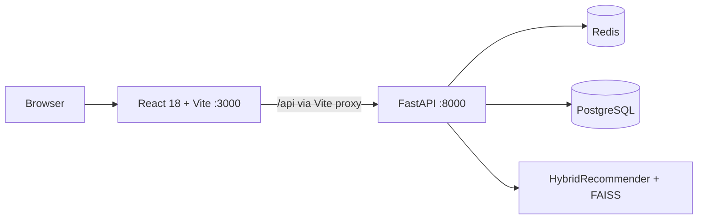

# 🤝 GoodBooks Recommender — Developer Handoff

> **Canonical onboarding document.** Read this first. It reflects the *actual* state of the
> repository as of **2026-08-06** (commit `d1ee337` on `main`), not the aspirational claims in
> the many legacy `*COMPLETE*`/`MISSION*` markdown files at the repo root — those are stale.

---

## ⏱️ In 5 Minutes

**What this is**: A full-stack AI book-recommendation platform.
- **Frontend**: React 18 + TypeScript + Vite "Futuristic Dashboard" (works, tested)
- **Backend**: Python FastAPI with hybrid ML recommendations (extensive code, **but does not yet
  serve the frontend's API contract** — see [The Critical Gap](#-the-critical-gap))

**Run the frontend** (works today):
```bash
npm install        # already installed
npm run dev        # → http://localhost:3000
```

**Run the backend** (optional — the frontend gracefully falls back to demo data without it):
```bash
python -m venv venv && source venv/bin/activate
pip install -r requirements.txt   # heavy: torch, faiss, sentence-transformers
uvicorn src.api.main:app --reload # → http://localhost:8000, docs at /docs
```

---

## 🗺️ In 30 Minutes

### Repo layout

| Path | What it is |
|---|---|
| `src/components/` | React UI (Dashboard, AI, Navigation, News, UI, Features) |
| `src/stores/` | Redux Toolkit slices: `dashboard`, `books`, `ai`, `user`, `features/{notes,community,analytics}` |
| `src/utils/api.ts` | **The API contract** — every endpoint the frontend calls (`API_ENDPOINTS`, `APIClient`, service objects) |
| `src/services/` | Legacy class-based services (partially redundant with `utils/api.ts`) |
| `src/api/main.py` | FastAPI app (~2100 lines). ⚠️ Has a **double `app = FastAPI()` bug** (see below) |
| `src/core/`, `src/models/`, `src/data/`, `src/news/`, `src/fakenews/` | Backend business logic, ML models, data loaders, subsystems |
| `dashboard/css/` + `src/styles/` | Global CSS + design system (Tailwind configured in `tailwind.config.js`) |
| `tests/` | Vitest suite (19 tests, all passing) |
| `docs/` | Reference docs (many stale — trust `HANDOFF.md` + `docs/PROJECT_STATUS.md` instead) |

### Architecture (what's real)



**Frontend data flow**: components → typed Redux slices (`useAppDispatch`/`useAppSelector` from
`src/hooks/redux.ts`) → `src/utils/api.ts` services → `/api/*` → Vite proxy → backend.

**Resilience pattern (defining feature)**: every API call has a graceful local/demo fallback
(`aiSlice` returns keyword-matched book suggestions, `NewsDashboard` falls back to demo stories,
`Dashboard` falls back to curated picks). The UI never breaks when the backend is down.

### 🔴 The Critical Gap (read before backend work)

**The frontend and backend do not speak the same API.** The frontend calls
`GET /api/books/recommend`, `GET /api/books/{id}`, `POST /api/ai/chat`, `/api/user/*`,
`/api/notes/*`, `/api/community/*`, `/api/analytics/*` — **none of these routes exist** in the
served backend.

Root causes, in `src/api/main.py`:
1. **Duplicate `app = FastAPI(...)`** at ~line 308 and ~line 571. The second assignment
   overwrites the first, so the news routers (`/api/news/*`) mounted on the first instance are
   **dead at runtime**. The `/fakenews` router is never mounted at all.
2. The only product endpoint, `POST /recommendations`, requires a JWT (`get_current_active_user`)
   that the frontend never sends, and it constructs `BookRecommendation(score=...)` while the
   model field is `hybrid_score` → **500 ValidationError at runtime**.
3. The `/api/v2/*` enhanced router is only mounted via `EnhancedFeaturesManager`, which is never
   called from `main.py`.

**Net effect today**: deploy the app → UI renders, every API call 404s/500s, fallbacks hide it
behind demo data. Fix the code before documenting "production ready."

---

## ✅ What Works Today (verified)

- **Frontend build & run**: `npm run dev` → all 8 routes render (Dashboard, Discover, Currently
  Reading, Wishlist, Analytics, Community, News) with sidebar, AI assistant chat, theme toggle,
  loading screen, error boundary, toasts.
- **Account creation + taste onboarding**: first-run 3-step flow (welcome → create account →
  taste quiz). After completing it, the app is **personalized** — see below.
- **Personalized recommendations (client-side engine)**: `src/utils/personalization.ts` ranks
  the curated catalog (`src/data/bookCatalog.ts`, 24 books) against the reader's taste profile
  (genres, moods, goal) and shows a *reason* on every pick ("Because you love Science Fiction").
  Works instantly, offline — no backend required. Account + preferences persist in localStorage.
- **Intelligent covers**: `src/components/UI/BookCover.tsx` — deterministic, genre-aware gradient
  covers (`src/utils/coverArt.ts`) render instantly for every book; real `cover_url` images
  lazily fade in over them and fall back to the generated art on error. No broken images, no CLS.
- **AI Assistant**: chat works even with the backend down (Cmd+K to toggle, quick actions,
  book-suggestion cards with ratings).
- **Redux**: 7 slices, localStorage persistence (`dashboard_state` + `goodbooks_user`), typed hooks.
- **Tooling**: Tailwind + PostCSS configured, Vitest (**37 tests** passing), ESLint (0 errors),
  `tsc --noEmit` clean, `npm run build` succeeds.
- **Backend modules**: extensive (auth/RBAC, caching, FAISS vector store, A/B testing, privacy,
  monitoring) — but largely unverified at runtime and not wired to the frontend.

---

## 🧪 Commands

| Command | Purpose | Status |
|---|---|---|
| `npm run dev` | Frontend dev server (:3000) | ✅ works |
| `npm test` | Vitest, once (non-watch) | ✅ 19 passing |
| `npm run test:watch` | Vitest watch | ✅ |
| `npm run type-check` | `tsc --noEmit` | ✅ clean |
| `npm run lint` | ESLint | ✅ 0 errors |
| `npm run build` | Production build → `dist/` | ✅ |
| `npm run format` | Prettier | ✅ |
| `uvicorn src.api.main:app --reload` | Backend (:8000) | ⚠️ boots, heavy startup, API contract wrong |
| `python -m pytest` | Backend tests | ⚠️ no verified passing suite yet |
| `docker-compose up` | api + redis + postgres | ⚠️ ships the broken API surface |

---

## ⚠️ Gotchas (learned the hard way)

1. **Apple Double files (`._*`)** regenerate constantly on this macOS/APFS volume. They corrupted
   `.git` before. Clean before committing/tests: `find . -name '._*' -not -path './node_modules/*' -delete`.
   `.gitignore` and `vitest.config.ts` (`exclude: ['**/._*']`) already protect against them.
2. **`process.env` is NOT available in the browser** — always use `import.meta.env.*` (see
   `src/vite-env.d.ts`). This crashed the app at runtime before being fixed.
3. **CSP** in `index.html` has `connect-src 'self'` — API URLs must be relative (`/api/...`)
   through the Vite/nginx proxy, NOT absolute `http://localhost:8000`.
4. **typescript-eslint v6**: config names need the `plugin:` prefix; `no-non-null-assertion` is an
   error; `security/detect-object-injection` is a warn (it flags safe dictionary access).
5. **Pydantic conflict**: `requirements.txt` has `pydantic>=1.10` (code uses v1 syntax) AND
   `pydantic-settings>=2.0` (needs v2). Don't bump pydantic without migrating `@validator`/`class Config`.
6. **Never edit the first `app = FastAPI(...)` block** in `main.py` — routes added there are
   silently discarded. There must be exactly ONE app instance.
7. **`npm test` runs `vitest run`** (non-watch). Use `npm run test:watch` for watch mode.
8. **Two stores exist**: `src/store/store.ts` (dead, legacy) vs `src/stores/store.ts` (live).
   Import from `src/stores`.

---

## 🚀 First Tasks (priority order)

See `docs/DEPLOYMENT_PLAN.md` for the full robust plan. Quick start:

1. **P0 — Fix the double-app bug** in `src/api/main.py` (single `app`, re-mount news router after
   final app creation). Restores `/api/news/*`.
2. **P0 — Fix `BookRecommendation(score=...)`** → use the model's `hybrid_score` field.
3. **P0 — Build the missing REST layer**: `/api/books/*`, `/api/ai/*`, `/api/user/*`,
   `/api/analytics/*` matching `src/utils/api.ts`, reusing existing logic
   (`HybridRecommender`, `BookVectorStore`, `RAGExplanationService`).
4. **P1 — Wire `booksSlice` into Dashboard/Discover** (the thunks exist but nothing dispatches
   them for real data), replace the "Coming soon" placeholders, delete dead code.
5. **P2 — Reproducibility**: Python lockfile, secrets out of `docker-compose.yml`, Alembic migrations.
6. **P3 — Deploy**: real `docker-compose.prod.yml` + nginx, then K8s manifests.

---

## 📚 Where to get help

- **This file** — canonical state + gotchas
- `docs/PROJECT_STATUS.md` — honest, single-source status
- `docs/DEPLOYMENT_PLAN.md` — the robust deployment roadmap
- `src/utils/api.ts` — the frontend→backend contract (ground truth for the API)
- `/memories/repo/goodbooks-learnings.md` — verified environment learnings
- `.github/instructions/*` — per-filetype agent coding rules
- `AGENTS.md` / `.github/copilot-instructions.md` — repo conventions
