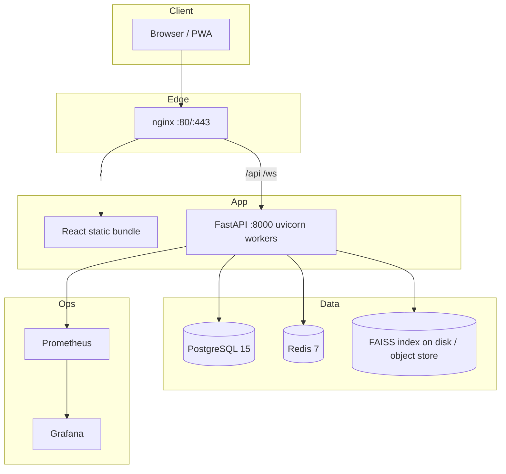

# 🚀 GoodBooks Recommender — Robust Deployment Plan

> **Status**: Planning document · **Date**: 2026-08-06 · **Owner**: Engineering
> **Goal**: Take the project from "frontend works, backend contract broken" to a logically
> sound, efficiently deployable, production-grade system — without over-engineering.

---

## 0. Executive Summary

The frontend is healthy (all routes, Redux, Tailwind, tests). The backend is the blocker: the
served FastAPI app does not expose a single endpoint the frontend calls. Before any deployment
claim, we must (1) fix a structural bug, (2) build the real API surface, (3) make the build
reproducible, and (4) ship a deployable topology. This plan sequences that work so each step is
independently verifiable and deploys cleanly.

**Guiding principles** (keep these throughout):
- **One contract**: `src/utils/api.ts` is the single source of truth for the API. Backend must
  satisfy it (or the contract changes deliberately, in a reviewed PR).
- **Graceful degradation stays**: the fallback pattern is a feature, not a hack — keep it, but
  make real data win by default.
- **Deploy early, deploy often**: a working `docker-compose` stack on day 1 of P1, not at the end.
- **No new dependencies without a lockfile**: reproducibility first.

---

## 1. Target Architecture



- **Single origin, path-based routing** — one nginx fronts static assets + API + WebSocket.
  Satisfies the strict CSP without CORS complexity.
- **Stateful services (PG, Redis) are excluded from the app tier** — separate containers
  (compose) or StatefulSets (K8s) so app deploys never lose data.
- **The ML model is a build artifact** (see §4.4) — pre-trained and loaded from disk, never
  trained at container start.

---

## 2. Phase 0 — Fix the Broken Foundation (half day)

*Directly unblocks every backend feature. Each item is small and independently testable.*

### 2.1 Fix the duplicate `app` bug — `src/api/main.py`
- There are two `app = FastAPI(...)` assignments (~line 308 and ~line 571). The first mounts the
  news routers; the second overwrites it. **Result: `/api/news/*` 404s at runtime.**
- **Fix**: keep exactly ONE app instance. Move all router includes (`news`, `fakenews`, `v2`,
  `newsletter`) to *after* the final `app` is created, inside a single `register_routers(app)`
  helper. Add a startup assertion that logs the mounted route count so this class of bug is
  caught immediately:
  ```python
  @app.on_event("startup")
  async def _log_routes():
      routes = sorted({getattr(r, "path", "") for r in app.routes if getattr(r, "path", "")})
      logger.info("Serving %d routes: %s", len(routes), routes[:20])
  ```

### 2.2 Fix the `BookRecommendation` ValidationError
- `src/api/main.py` builds `BookRecommendation(..., score=...)` but the model field is
  `hybrid_score` → 500 at runtime. Align the constructor with the Pydantic model (or add a
  `score` alias with `validation_alias`/`alias` — pick one and test it).

### 2.3 Decide the auth posture
- The only real endpoint (`POST /recommendations`) requires JWT; the frontend sends none.
- **Decision**: ship an anonymous/demo path for the read-heavy discovery endpoints
  (`/api/books/*`) for this release, gated by a `DEV_ANONYMOUS=true` env var, and require JWT for
  write endpoints (notes, community, preferences). Login UI is a P2 item.

### Verification (Phase 0)
```bash
# backend boots, /health green, news router live
uvicorn src.api.main:app
curl -s localhost:8000/health | jq .status        # "healthy"
curl -s localhost:8000/api/news/stories/trending   # 200, not 404
```

---

## 3. Phase 1 — Build the Real API Surface (1–2 weeks)

*Implement the endpoints the frontend already calls. Reuse the existing business logic.*

### 3.1 Route inventory (from `src/utils/api.ts` — the contract)

| Group | Routes | Reuse |
|---|---|---|
| **books** | `GET /api/books` (paginated), `GET /api/books/{id}`, `GET /api/books/search?q=`, `GET /api/books/recommend?user_id&limit&strategy&genres`, `GET /api/books/{id}/similar` | `HybridRecommender`, `BookVectorStore`, `DataLoader` |
| **ai** | `POST /api/ai/chat`, `POST /api/ai/tooltip`, `GET /api/ai/analysis`, `POST /api/ai/predict` | `RAGExplanationService`, vector store |
| **user** | `GET /api/user/profile`, `GET/PUT /api/user/preferences`, `GET /api/user/history`, `GET /api/user/favorites` | `UserProfileManager` |
| **notes** | `GET/POST /api/notes`, `PUT/DELETE /api/notes/{id}`, `GET /api/notes/search` | notes slice contract |
| **community** | `GET/POST /api/community/posts`, `GET/POST /api/community/comments`, `discussions`, `reviews` | community slice contract |
| **analytics** | `GET /api/analytics/dashboard`, `/reading`, `/trends`, `/performance` | `RealTimeAnalytics`, `RecommendationMetrics` |
| **news** | `GET /api/news/stories/trending`, `GET /api/news/expand/{id}` (restore via 2.1) | news subsystem |

### 3.2 Conventions (logical & consistent)
- **Router organization**: one module per group in `src/api/routers/`
  (`books.py`, `ai.py`, `user.py`, `notes.py`, `community.py`, `analytics.py`). `main.py` only
  assembles them — it stops being a 2100-line file.
- **Response envelope** (matches `src/api/docs.py`): `{"data": ..., "meta": {page, total, limit}}`
  for lists; standardized `{"error": {"code", "message", "details"}}` for errors via a shared
  exception handler (reuse `src/core/exceptions.py`).
- **Pagination**: `limit` (default 20, max 100) + `offset`, always returning `total`.
- **Validation**: Pydantic models per route (patterns exist in `src/api/docs.py`); sanitize
  user-generated content.
- **Caching**: use `AsyncCacheManager` (Redis with in-memory fallback) — 5-min TTL on
  recommendations, 1-min on trending.

### 3.3 Repoint or rename — pick ONE contract
- Decision: **backend grows to meet `src/utils/api.ts`** (frontend already works). Do not touch
  the frontend endpoint map in this phase. Any future contract change goes through a reviewed PR
  updating BOTH sides + this doc.

### Verification (Phase 1)
```bash
curl -s "localhost:8000/api/books/recommend?limit=3" | jq .data    # 3 books
curl -s "localhost:8000/api/books/search?q=dune" | jq .data       # results
curl -s localhost:8000/api/analytics/dashboard | jq .data         # stats
# frontend with backend up: real data replaces demo data automatically
```

---

## 4. Phase 2 — Data, Models & Reproducibility (1–2 weeks, parallel)

### 4.1 Database schema (PostgreSQL) + Alembic
- Add Alembic; initial migration with: `users`, `sessions`, `books`, `ratings`,
  `user_preferences`, `notes`, `community_posts`, `community_comments`, `recommendation_logs`.
- `DataLoader` (CSV) remains for dev seed; DB is the system of record in prod.
- Wire `OAuth2Manager.create_user/authenticate_user` to real DB queries (currently no DB layer).

### 4.2 Redis
- Required for: real-time analytics, A/B testing, session store. Keep graceful fallback when
  absent (already the pattern).

### 4.3 Model serialization (kill train-on-boot)
- `ModelManager` already supports save/load + hot-swap. Serialize trained `HybridRecommender`
  (+ FAISS index) to a versioned artifact at build time (`scripts/train_model.py` → `artifacts/`),
  and load at startup (fast). Keep a `RETRAIN_ON_BOOT=1` escape hatch for dev.
- This cuts backend boot from minutes to seconds — a prerequisite for `docker-compose up` DX.

### 4.4 Reproducibility & secrets
- Python lockfile: `pip freeze > requirements-lock.txt` (or migrate to Poetry — decision needed,
  but lockfile is mandatory either way).
- Remove hardcoded `POSTGRES_PASSWORD=postgres` + default `SECRET_KEY` from `docker-compose.yml`
  → `${VAR}` from `.env` (commit `.env.example` only).
- Add `pytest` passing suite + `requirements-dev.txt` (referenced by CI but missing).

### 4.5 Data pipeline
- Goodreads UCSD datasets (`goodreads_books.json.gz`, `goodreads_reviews_dedup.json.gz`) →
  `scripts/download_datasets.sh` + `src/data/etl_pipeline.py` → Postgres. DVC or plain
  checksum-versioned `data/` for now; Airflow/MLflow stay aspirational (don't wire them in).

---

## 5. Phase 3 — Deployable Topology (1 week)

### 5.1 `docker-compose.prod.yml` (the primary deploy path)
Services: `postgres:16-alpine`, `redis:7-alpine`, `backend` (uvicorn, 2–4 workers, healthcheck on
`/health`, non-root), `frontend` (nginx serving `dist/`, SPA routing, gzip/brotli, cache headers),
optional `prometheus` + `grafana`.

### 5.2 nginx (`nginx/nginx.conf`)
- `/api/*` and `/ws/*` → backend:8000 (WebSocket upgrade headers); `/*` → static SPA (fallback to
  `index.html`); gzip; security headers; rate limiting on `/api/auth/*`.

### 5.3 Health & observability
- `/health` already exists (enhanced, multi-component) — keep as the single probe.
- Prometheus `/metrics` already exists — point Grafana at it.
- Add `scripts/smoke-test.sh` (curl each critical endpoint, print ✅/❌) for CI + post-deploy.

### 5.4 Kubernetes (P2+ of deployment; do not block on it)
- When ready: `k8s/base/` (namespace, configmap, sealed-secret, backend Deployment + HPA + PDB,
  frontend Deployment, PG StatefulSet, Redis Deployment, ingress with cert-manager, network policy,
  CronJobs for ETL + nightly `pg_dump`). Do this AFTER compose is proven; compose is the
  day-1 path.

### 5.5 Environments
- `.env.example` with: `POSTGRES_*`, `REDIS_URL`, `JWT_SECRET`, `VITE_API_URL` (blank = same-origin),
  `DEV_ANONYMOUS`, `RETRAIN_ON_BOOT`.
- `ENV=dev|staging|prod` selects compose overlay (`docker-compose.override.yml` for dev volumes).

---

## 6. Phase 4 — Testing & CI Gates (ongoing from Phase 1)

| Gate | Tool | Threshold |
|---|---|---|
| Frontend unit | Vitest | `npm test` green (grow past 19) |
| Frontend type | `tsc --noEmit` | 0 errors |
| Frontend lint | ESLint | 0 errors |
| Backend unit | pytest | ≥ 60% backend coverage, all green |
| API integration | pytest + httpx (testcontainers-postgres) | all routes return correct shape |
| E2E | Playwright (per the plan's E2E strategy; CI only) | full user journey green |
| Smoke | `scripts/smoke-test.sh` | all ✅ post-deploy |

CI (GitHub Actions): lint + type-check + unit tests on PR; build + smoke on merge to `main`.

---

## 7. Rollout Sequence (what "deployed" looks like)

1. **Day 1 of P1**: `docker-compose.prod.yml` up locally with backend → frontend shows **real**
   data (recommendations from `HybridRecommender`). This is the milestone that changes everything.
2. **Staging**: same compose on a VM behind nginx + Let's Encrypt; `scripts/smoke-test.sh` green.
3. **Production**: same image, env-specific `.env`, Grafana dashboards, nightly `pg_dump` cron.
4. **K8s** (only when scale demands): lift the compose topology into manifests (§5.4).

---

## 8. Explicit Non-Goals (this quarter)

- ❌ Spinning up Airflow / MLflow / Milvus / Pinecone (deps present, no product need yet).
- ❌ Multi-region / multi-AZ HA (documented later; PDBs/HPA only when K8s lands).
- ❌ OAuth social login (P2+; JWT email/password + `DEV_ANONYMOUS` is enough now).
- ❌ Rebuilding the recommendation algorithm (two-tower/ANN is a roadmap item, not a blocker).
- ❌ Carving out fakenews/news into a separate product (defer until the core is live).

---

## 9. Definition of "Done" (verifiable)

- [ ] `curl /health` → healthy on a fresh `docker-compose.prod.yml up`
- [ ] Frontend shows live data for books/analytics/news with backend up (no demo-data path hit)
- [ ] All 20 endpoints from `src/utils/api.ts` return 200 with the documented shape
- [ ] `pip freeze` lockfile committed; no secrets in compose; `.env.example` complete
- [ ] `scripts/smoke-test.sh` all ✅
- [ ] Backend boots in < 30s (pre-trained artifact, no train-on-boot)
- [ ] `npm test`, `npm run type-check`, `npm run lint`, `python -m pytest` all green in CI

---

## 10. Risks & Mitigations

| Risk | Likelihood | Mitigation |
|---|---|---|
| Pydantic v1/v2 dependency conflict | High | Pin `pydantic==1.10.x` + `pydantic-settings` compatible version; CI install test |
| torch/faiss install size & CPU-only in prod | Medium | `faiss-cpu`, `torch` CPU wheel; build once, cache layer |
| ML cold start on first request | Medium | Pre-trained artifact (4.3) |
| Contract drift between FE/BE | Medium | `src/utils/api.ts` is the contract; integration tests assert it |
| Backend 2100-line `main.py` refactor risk | Medium | Phase 0 is surgical; Phase 1 moves routers without changing behavior |

---

## 11. Immediate Next Actions (who does what)

1. **Engineer A (backend)**: Phase 0 (2.1–2.3) + Phase 1 routers, starting with `books`.
2. **Engineer B (data)**: Phase 2 — Alembic schema, ETL script, model serialization, lockfile.
3. **Engineer A/B**: Phase 3 compose + nginx + smoke script.
4. **Everyone**: keep `HANDOFF.md` and `docs/PROJECT_STATUS.md` current as you go.
